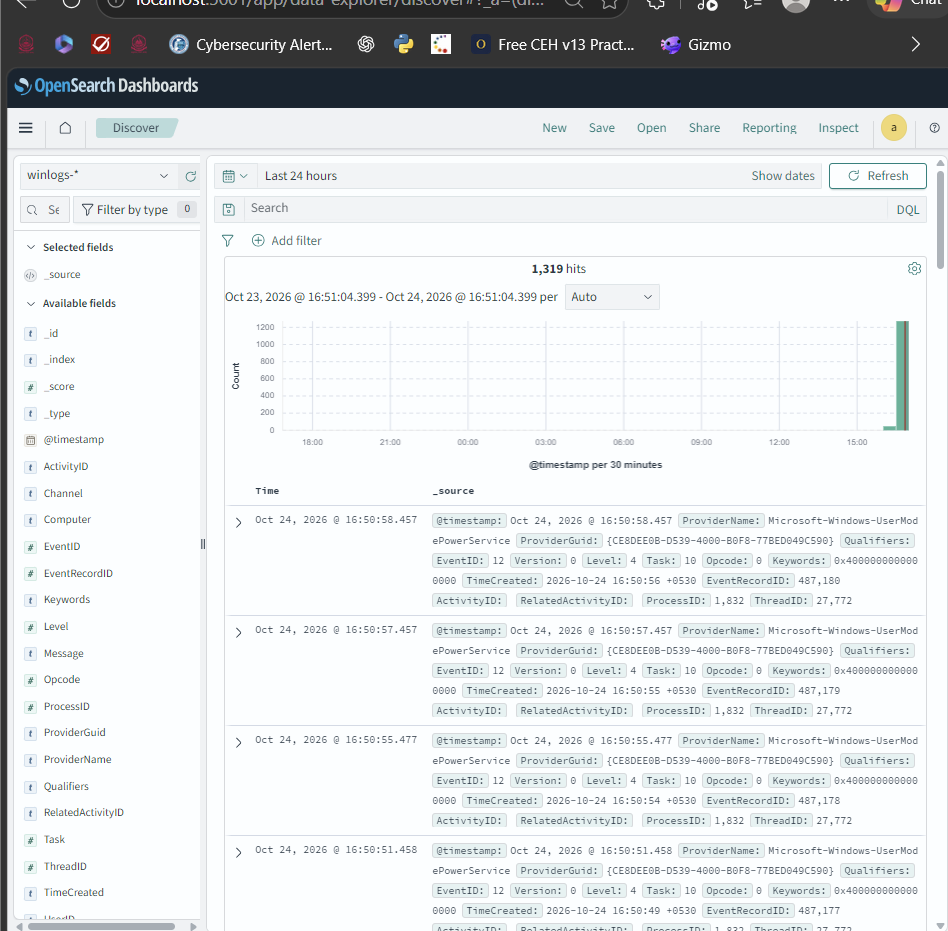
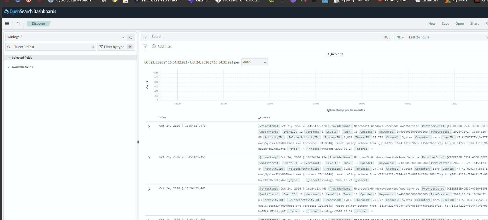
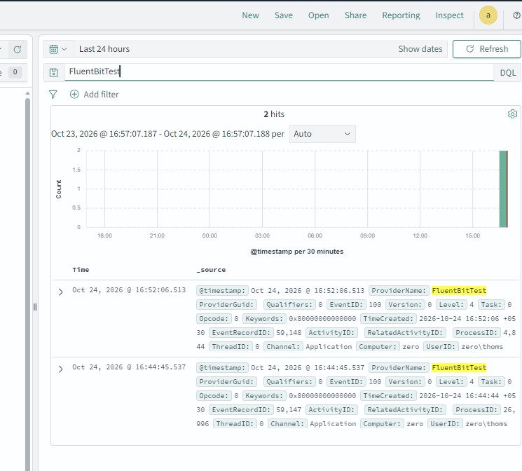

# Windows Event Logs to OpenSearch with Fluent Bit

Ships the Windows Application, System and Security event logs to an OpenSearch 2.19.7 cluster (Docker) using Fluent Bit 5.1.3, and views them in OpenSearch Dashboards.

## Architecture

```
Windows Event Log (Application, System, Security)
        |  winevtlog input
        v
Fluent Bit 5.1.3 (Windows service, bookmark in SQLite)
        |  HTTPS bulk API, port 9200
        v
OpenSearch 2.19.7 in Docker (daily indices winlogs-YYYY.MM.DD)
        v
OpenSearch Dashboards (index pattern winlogs-*, Discover)
```

Fluent Bit stores no logs. It only keeps a read-position bookmark; OpenSearch stores the indexed events in its container data volume.

## Why not Winlogbeat / Filebeat

| Version | Result |
|---|---|
| 9.5.5 | `Invalid index name [_license]`. Beats 8.x/9.x call `/_license`, which OpenSearch does not have. |
| 7.12.1 (OSS) | `Action/metadata line [1] contains an unknown parameter [_type]`. Beats 7.x send `_type`, which OpenSearch 2.x removed. |

Fluent Bit has a native OpenSearch output with `Suppress_Type_Name On`, which fixes this.

## Setup

1. Start OpenSearch (Docker Desktop running first):
   ```powershell
   docker start opensearch-node1 opensearch-node2
   Start-Sleep 30
   docker start opensearch-dashboards
   curl.exe -k -u 'admin:<password>' "https://localhost:9200/_cluster/health?pretty"
   ```
2. Download `fluent-bit-5.1.3-win64.exe` from packages.fluentbit.io, verify its SHA256 against the published checksum, and install it to `C:\Program Files\fluent-bit`.
3. Copy [`config/fluent-bit.conf`](config/fluent-bit.conf) to `C:\Program Files\fluent-bit\conf\` and set the real password in `HTTP_Passwd`.
4. Test in the foreground, then Ctrl+C after ~30 seconds. There should be no `[error]` lines:
   ```powershell
   cd "C:\Program Files\fluent-bit\bin"
   .\fluent-bit.exe -c "..\conf\fluent-bit.conf"
   ```
5. Create the Windows service and start it:
   ```powershell
   New-Service -Name "fluent-bit" -DisplayName "Fluent Bit" -StartupType Automatic -BinaryPathName '"C:\Program Files\fluent-bit\bin\fluent-bit.exe" -c "C:\Program Files\fluent-bit\conf\fluent-bit.conf"'
   Start-Service fluent-bit
   ```
6. In Dashboards: Dashboards Management > Index patterns > Create index pattern `winlogs-*`, time field `@timestamp`.

## Configuration notes

| Setting | Why |
|---|---|
| `String_Inserts Off` | `StringInserts` has mixed types; OpenSearch mapped it as `long` and rejected text values (`mapper_parsing_exception`). |
| `Suppress_Type_Name On` | Removes `_type`, which OpenSearch 2.x rejects. |
| `Buffer_Size 5MB` | Fixes `cannot increase buffer` warnings on bulk responses. |
| `Logstash_Format On` + `Logstash_Prefix winlogs` | One index per day: `winlogs-YYYY.MM.DD`. |
| `DB ...sqlite` | Stores the read position so events are not lost or duplicated across restarts. |
| `tls.verify Off` | Self-signed certificate; local testing only. |

## Problems and fixes

| Problem | Fix |
|---|---|
| `_license` error with Beats 9.x | Use Fluent Bit |
| `_type` error with Beats 7.x | `Suppress_Type_Name On` |
| `StringInserts ... type [long]` | `String_Inserts Off`, delete the index with the bad mapping |
| `cannot increase buffer` | `Buffer_Size 5MB` |
| `.ps1` scripts not signed | `PowerShell.exe -ExecutionPolicy Bypass -File ...` |
| `sc.exe create` printed help | Use `New-Service` |

## Verification

An end-to-end test event was created:

```powershell
eventcreate /l APPLICATION /t INFORMATION /id 100 /so FluentBitTest /d "fluent bit service test"
```

Discover with `winlogs-*` shows ingested events (1,319 hits, later 1,425):



Events are arriving live into `winlogs-2026.10.24`:



Searching `FluentBitTest` returns the 2 test events (Channel Application, EventID 100):



## Operating

```powershell
# start
docker start opensearch-node1 opensearch-node2; Start-Sleep 30; docker start opensearch-dashboards
Start-Service fluent-bit

# stop
Stop-Service fluent-bit
docker stop opensearch-dashboards opensearch-node1 opensearch-node2

# do not start at boot
Set-Service fluent-bit -StartupType Manual
```

## Security notes

- Never commit the real admin password. The config here uses `CHANGE_ME`.
- `tls.verify Off` is for local use. Otherwise set `tls.ca_file` to the OpenSearch CA.
- Prefer a dedicated OpenSearch user limited to `winlogs-*` instead of `admin`.
- Add an Index State Management policy to delete old indices, since Security logs grow quickly.
